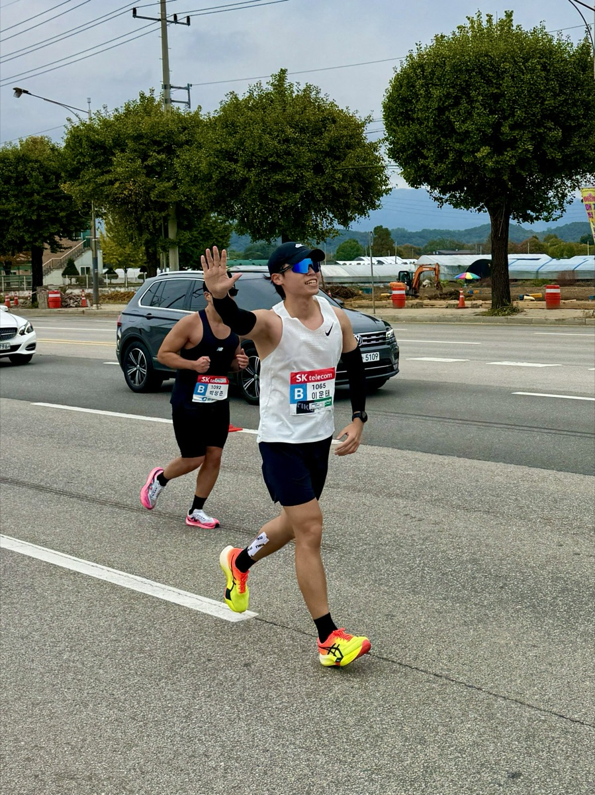

### Hi, I'm Untae 👋

*A user first, a developer second.*

I'm a software engineer. Most of the services I've built started with an everyday frustration I experienced myself, and I've improved them by watching how people react when they actually use them.

#### 🛠️ How I Work
- **Step outside instead of just thinking at my desk.** I went out to bus stops in person to share Salmonbus and hear directly from commuters. While building Ttarawaing, when I learned a similar app already existed, I got off the subway two stops early after class and walked the route myself to find what riders were still missing.
- **Build structure that makes teamwork easier.** Across **100+ PR reviews**, I learned to write reading-order guides for large PRs and actively use visual diagrams to share context. I also made it a habit to define clear completion criteria before meetings so good conversations turn into real decisions.

#### 📦 Projects
- 🚌 **[Salmonbus](https://github.com/woowacourse-teams/2026-salmonbus)** *(2026.07 – Present)* — Predicts how many seats will be free when an express bus reaches your stop.
- 🚲 **[Ttarawaing](https://github.com/bigcloud07/ttarawaing)** *(2026.07 – 2026.08)* — Route planner for Seoul's public bikes that recommends pickup and return stations along with walk–ride–walk routes.
- 🏃 **[RIKU](https://github.com/RIKU-WebApp/RIKU-FE)** *(2024.08 – 2025.04)* — Web service for Konkuk University's running club, built to solve run notices getting buried in group chats and attendance records scattered across different places.

#### 🏃‍♂️ Life Outside Code
I love marathons—a form of moving meditation for me. I've finished **9 marathons in total, including 5 full marathons**, with a personal best of **3:35:01**.

> *"When a race gets hard, I tell myself one thing: just don't stop. I work and learn the same way."*

  
  

