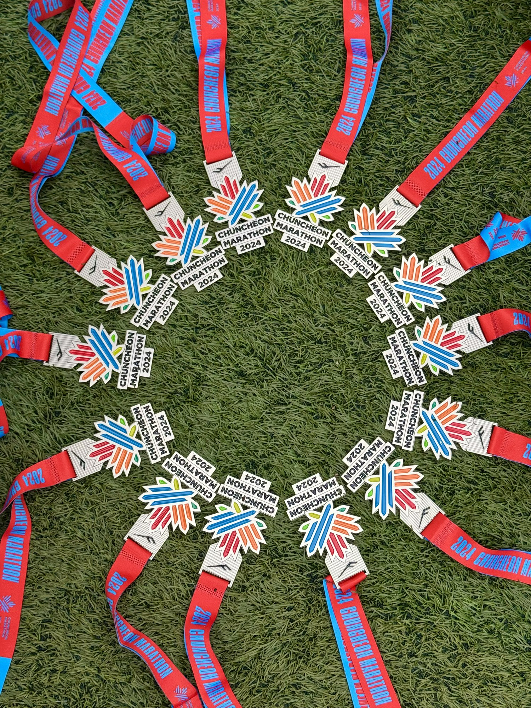

### Hi, I'm Untae 👋

*A user first, a developer second.*

  
  

I'm a software engineer. Most of what I've built started with an everyday frustration of my own, and I've improved it by watching how people actually use it.

#### 🛠️ How I Work
- **Step outside instead of just thinking at my desk.** I went to bus stops to introduce Salmonbus to commuters and hear from them directly. While building Ttarawaing, my bike-route planner, I learned a similar app already existed. So I got off the subway two stops early on my way home and walked the route myself to find what bike riders still needed.
- **Build structure that makes teamwork easier.** Across **100+ PR reviews**, I learned to write reading-order guides for large PRs and use diagrams to share context. I also make a habit of defining what "done" looks like before each meeting so good conversations turn into real decisions.

#### 📦 Projects
- 🚌 **[Salmonbus](https://github.com/woowacourse-teams/2026-salmonbus)** *(2026.07 – Present)* — Predicts how many seats will be free when an express bus reaches your stop.
- 🚲 **[Ttarawaing](https://github.com/bigcloud07/ttarawaing)** *(2026.07 – 2026.08)* — Route planner for Seoul's public bikes that recommends pickup and return stations along with walk–ride–walk routes.
- 🏃 **[RIKU](https://github.com/RIKU-WebApp/RIKU-FE)** *(2024.08 – 2025.04)* — Web app for Konkuk University's running club that keeps run announcements from getting buried in group chats and puts attendance records in one place.

#### 🏃‍♂️ Life Outside Code
I love running marathons—it's moving meditation for me. I've finished **9 races, including 5 full marathons**, with a marathon personal best of **3:35:01**.

> *When a race gets hard, I tell myself one thing: just don't stop. I work and learn the same way.*

  
  

